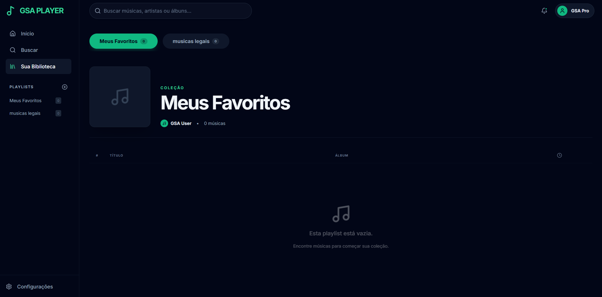

# 🎵 GSA Player


Player de música minimalista feito com **React** e a **API do Deezer**: busca em tempo real, playlists próprias e um player com visual glassmorphism que funciona bem no celular.

<div align="center">
  
  
</div>

## ✨ Funcionalidades

**Descoberta**
- Rolagem infinita: novas músicas carregam conforme você desce a página
- Botão "Atualizar tudo" alterna entre os charts globais e palavras-chave em alta
- Seção de artistas populares

**Busca**
- Faixas, álbuns e artistas, com resultados enquanto você digita

**Playlists (CRUD completo)**
- Crie, edite e exclua playlists; adicione e remova faixas
- Favoritos com um clique ("Curtir")
- Tudo salvo no `localStorage`

**Player**
- Play/pause, próxima/anterior, aleatório e repetir
- Barra de progresso clicável e controle de volume
- Navegação inferior estilo app no celular

## 🛠️ Tecnologias

| Camada | Tecnologia |
|---|---|
| Interface | React 19 + TypeScript |
| Build | Vite |
| Estilo | Tailwind CSS |
| Ícones | Lucide React |
| Estado | Context API |
| Dados | API do Deezer |

## 🚀 Como rodar

```bash
git clone https://github.com/MChaves-21/gsa.git
cd gsa
npm install
npm run dev
```

## 📝 Próximos passos

- [ ] Letras sincronizadas com a música
- [ ] Modo offline (PWA)
- [ ] Login para sincronizar playlists na nuvem
